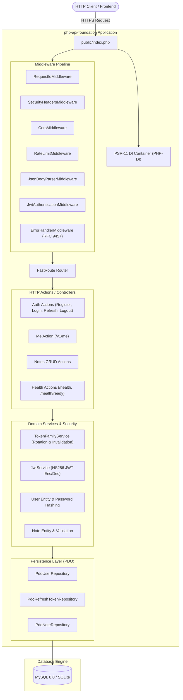
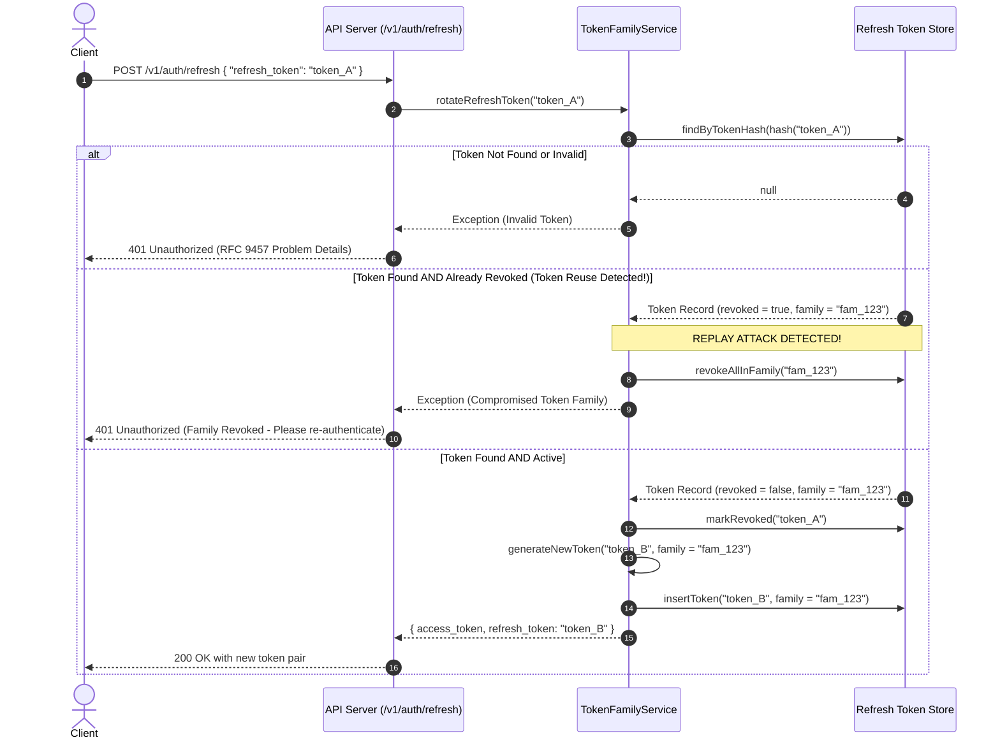
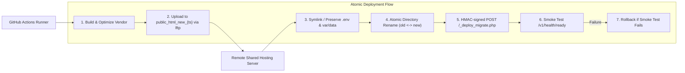

# php-api-foundation

[](https://github.com/thesanketkale/php-api-foundation/actions/workflows/ci.yml)
[](https://github.com/thesanketkale/php-api-foundation/releases)
[](https://www.php.net/)
[](LICENSE)
[](openapi/openapi.yaml)
[](phpstan.neon)
[](.php-cs-fixer.dist.php)

A production-grade, dependency-light REST API foundation built on PHP 8.3+. Features JWT authentication with rotating refresh token families, Argon2id password hashing, RFC 9457 Problem Details error handling, PDO migrations, an OpenAPI 3.1 contract, and dual deployment pipelines for shared hosting (cPanel/FTP near-atomic swap) and cloud container platforms (AWS ECS Fargate and Azure App Service via OpenID Connect).

---

## 1. Why It Exists

Modern PHP REST APIs often start with monolithic full-stack frameworks (like Laravel or Symfony). While powerful, they carry significant overhead: hundreds of megabytes in vendor files, cold start penalties, complex dependency trees, and deployment workflows that demand root SSH access, long-running daemon workers, or specialized hosting.

Conversely, bare PHP micro-scripts or minimal skeletons often omit production requirements: token rotation, input validation, structured database migrations, standard error handling, rate limiting, and automated CI/CD.

`php-api-foundation` fills this gap:

| Dimension | Laravel / Symfony API | Bare PHP Skeleton | `php-api-foundation` |
|:---|:---|:---|:---|
| **Base Memory Footprint** | ~35 MB - 60 MB | ~4 MB | **~12 MB - 16 MB** |
| **Cold Start Response** | 30ms - 80ms | < 5ms | **< 8ms** |
| **Authentication** | Sanctum / Passport (Heavy) | Often omitted or basic | **JWT + Rotating Refresh Families** |
| **Error Format** | Framework-specific JSON | Custom / Ad-hoc | **RFC 9457 Problem Details** |
| **Database Layer** | Heavy ORM (Eloquent / Doctrine) | Raw queries / Unstructured | **PDO Prepared Statements + Phinx** |
| **Shared Hosting Support** | Challenging (needs CLI/cron workarounds) | Manual FTP file upload | **Automated near-atomic swap + HMAC migrations** |
| **Cloud Container Ready** | Containerized | Often no Dockerfile | **Production multi-stage Docker + OIDC CI/CD** |

---

## 2. Features

- **PHP 8.3+ Strict Typing**: `declare(strict_types=1);` in every file, PSR-12 compliance, PSR-4 autoloading, and PHPStan analysis at maximum level.
- **Robust JWT Authentication**:
  - Stateless HS256 JWT access tokens (15-minute default TTL).
  - Secure rotating refresh tokens (7-day default TTL).
  - **Token Family Revocation**: Detects token reuse (replay attacks) and immediately invalidates all tokens in the compromised family.
- **Enterprise Security Baseline**:
  - Passwords hashed with Argon2id (`PASSWORD_ARGON2ID`).
  - Standardized security headers (HSTS, CSP, X-Frame-Options, X-Content-Type-Options, Referrer-Policy).
  - UUIDv4 entity identifiers preventing enumeration attacks.
  - Granular token bucket rate limiting (APCu and atomic file-lock driver with flock).
- **Standards-Compliant API**:
  - RFC 9457 Problem Details (`application/problem+json`) for all error responses.
  - Standardized payload envelopes for collection pagination and entity metadata.
  - OpenAPI 3.1 specification validated with Spectral rulesets.
- **Database Persistence**:
  - Exclusive use of PDO prepared statements (`ERRMODE_EXCEPTION`, `ATTR_EMULATE_PREPARES => false`, `utf8mb4`).
  - Dual database driver support: SQLite (local/test) and MySQL 8.0 (production).
  - Reversible database migrations using Phinx.
- **Deployment Automation**:
  - **Shared Hosting**: Automated `lftp` script with timestamped staging, near-atomic directory swap, HMAC-authenticated one-time migration execution, and automatic rollback on smoke test failure.
  - **Cloud Platforms**: GitHub Actions OIDC workflows deploying containerized instances to AWS ECS Fargate and Azure App Service without stored cloud credentials.

---

## 3. Quickstart

Run these commands from a clean terminal to spin up the API locally:

```bash
# 1. Clone the repository
git clone https://github.com/thesanketkale/php-api-foundation.git
cd php-api-foundation

# 2. Install dependencies
composer install

# 3. Initialize environment file and generate JWT secret
cp .env.example .env
php -r "file_put_contents('.env', preg_replace('/JWT_SECRET=.*/', 'JWT_SECRET=' . bin2hex(random_bytes(32)), file_get_contents('.env')));"

# 4. Run database migrations (SQLite by default)
vendor/bin/phinx migrate -e default

# 5. Start the PHP built-in web server
php -S 0.0.0.0:8080 -t public
```

Test that the service is running:
```bash
curl http://localhost:8080/v1/health/ready
```

---

## 4. Architecture

### System Context



### Refresh Token Rotation & Family Revocation Flow



### Shared Hosting Near-Atomic Swap Deployment



---

## 5. Configuration Reference

The application is configured using environment variables loaded from `.env` via `vlucas/phpdotenv`:

| Variable | Type | Default | Description |
|:---|:---:|:---|:---|
| `APP_NAME` | string | `php-api-foundation` | Application name identifier |
| `APP_ENV` | string | `production` | Environment (`development`, `testing`, `production`) |
| `APP_DEBUG` | bool | `false` | Enable verbose error traces (disable in production) |
| `APP_URL` | string | `http://localhost:8080` | Public base URL of the API instance |
| `DB_CONNECTION` | string | `sqlite` | Database engine (`sqlite` or `mysql`) |
| `DB_HOST` | string | `127.0.0.1` | MySQL server hostname / IP address |
| `DB_PORT` | int | `3306` | MySQL server port |
| `DB_DATABASE` | string | `var/data/database.sqlite` | SQLite file path or MySQL database name |
| `DB_USERNAME` | string | `root` | MySQL database username |
| `DB_PASSWORD` | string | `secret` | MySQL database password |
| `JWT_SECRET` | string | *Required* | 256-bit cryptographic secret for signing JWTs |
| `JWT_ISSUER` | string | `php-api-foundation` | JWT `iss` claim issuer identifier |
| `JWT_ACCESS_TTL` | int | `900` | Access token lifespan in seconds (15 minutes) |
| `JWT_REFRESH_TTL` | int | `604800` | Refresh token lifespan in seconds (7 days) |
| `RATE_LIMIT_ENABLED` | bool | `true` | Toggle HTTP request rate limiting middleware |
| `RATE_LIMIT_DRIVER` | string | `file` | Rate limit storage backend (`file` or `apcu`) |
| `RATE_LIMIT_MAX_REQUESTS`| int | `60` | Maximum allowed requests per window |
| `RATE_LIMIT_WINDOW_SECONDS`| int | `60` | Rate limiting sliding window in seconds |
| `DEPLOY_SECRET` | string | `secret` | HMAC secret for one-time shared hosting migration runner |
| `LOG_CHANNEL` | string | `stack` | Monolog channel configuration (`stack`, `stderr`, `file`) |

---

## 6. Usage Examples

### 1. Register a New User Account
```bash
curl -i -X POST http://localhost:8080/v1/auth/register \
  -H "Content-Type: application/json" \
  -d '{
    "email": "developer@example.com",
    "password": "CorrectHorseBatteryStaple123!",
    "name": "Jane Developer"
  }'
```

*Response (`201 Created`):*
```json
{
  "data": {
    "user": {
      "id": "e45a2781-64d8-4f81-a968-3866d92db7da",
      "email": "developer@example.com",
      "name": "Jane Developer",
      "created_at": "2026-10-25T12:00:00+00:00"
    },
    "tokens": {
      "token_type": "Bearer",
      "access_token": "eyJhbGciOi...",
      "expires_in": 900,
      "refresh_token": "e674b94a2846f481075677..."
    }
  }
}
```

### 2. Login
```bash
curl -i -X POST http://localhost:8080/v1/auth/login \
  -H "Content-Type: application/json" \
  -d '{
    "email": "developer@example.com",
    "password": "CorrectHorseBatteryStaple123!"
  }'
```

### 3. Retrieve Authenticated Profile
```bash
curl -i -X GET http://localhost:8080/v1/me \
  -H "Authorization: Bearer <ACCESS_TOKEN>"
```

### 4. Create and Paginate Notes
```bash
# Create note
curl -i -X POST http://localhost:8080/v1/notes \
  -H "Authorization: Bearer <ACCESS_TOKEN>" \
  -H "Content-Type: application/json" \
  -d '{
    "title": "Architecture Sync Notes",
    "content": "Discussed token family revocation and shared hosting deployments."
  }'

# Paginate notes
curl -i -X GET "http://localhost:8080/v1/notes?page=1&per_page=10&search=Architecture" \
  -H "Authorization: Bearer <ACCESS_TOKEN>"
```

*Paginated Response (`200 OK`):*
```json
{
  "data": [
    {
      "id": "0df62d29-04fa-4158-b617-f5da124871e9",
      "user_id": "e45a2781-64d8-4f81-a968-3866d92db7da",
      "title": "Architecture Sync Notes",
      "content": "Discussed token family revocation and shared hosting deployments.",
      "created_at": "2026-10-25T12:05:00+00:00",
      "updated_at": "2026-10-25T12:05:00+00:00"
    }
  ],
  "meta": {
    "pagination": {
      "total": 1,
      "page": 1,
      "per_page": 10,
      "total_pages": 1
    }
  }
}
```

### 5. RFC 9457 Validation Error Example
```bash
curl -i -X POST http://localhost:8080/v1/notes \
  -H "Authorization: Bearer <ACCESS_TOKEN>" \
  -H "Content-Type: application/json" \
  -d '{ "content": "Missing required title" }'
```

*Response (`422 Unprocessable Content`, `Content-Type: application/problem+json`):*
```json
{
  "type": "https://tools.ietf.org/html/rfc9457",
  "title": "Unprocessable Content",
  "status": 422,
  "detail": "The request payload failed validation.",
  "instance": "/v1/notes",
  "errors": {
    "title": "The title field is required."
  }
}
```

---

## 7. Troubleshooting & FAQ

#### Q: How do I run database migrations on shared hosting without SSH access?
> **A:** The automated deployment pipeline (`deploy/ftp/deploy.sh`) automatically uploads a temporary HMAC-signed runner (`deploy/ftp/migrate.php`) to `_deploy_migrate.php`, triggers it via an authenticated HTTP POST with a short-lived HMAC signature (`X-Deploy-Signature`), validates execution, and ensures self-destruction of the runner file. You can also trigger this script manually by computing an HMAC signature with your `DEPLOY_SECRET`.

#### Q: I receive a `401 Unauthorized` stating "Compromised token family detected".
> **A:** This occurs when a revoked refresh token is presented to `/v1/auth/refresh`. This indicates a potential token theft or replay attack. The application automatically revokes all active refresh tokens in that user's session family to protect the account. The user must authenticate again using `/v1/auth/login`.

#### Q: Which rate limiting driver should I use?
> **A:** For single-server or shared hosting deployments, the default `file` driver uses non-blocking file locks (`flock`) in `var/cache` and requires no extra extensions. If APCu is installed, set `RATE_LIMIT_DRIVER=apcu` for in-memory performance. For multi-container cloud deployments (ECS/App Service), consider offloading rate limiting to an API gateway (e.g., AWS WAF / Azure API Management).

---

## 8. Security & Known Limitations

- **Argon2id CPU & Memory Cost**: Passwords use Argon2id with recommended OWASP baseline memory and iteration costs. In constrained shared hosting environments with strict execution timeouts, calibrate costs accordingly in `config/dependencies.php`.
- **Clock Drift**: JWT verification enforces a 60-second leeway (`$jwtService->decodeToken($token, $leeway = 60)`). Ensure server NTP synchronization is enabled.
- **Shared File Locks**: The file rate limiter relies on local filesystem locks (`flock`). In multi-container horizontal scale-out clusters, use APCu or upstream gateway rate limiting.

---

## 9. Verification Status

In accordance with open source quality standards, this table distinguishes between automated tests proven in CI and environments that require owner live credentials:

| Component / Feature | Verification Method | Environment | Status | Runbook / Evidence |
|:---|:---|:---:|:---:|:---|
| **Unit & Integration Suite** | PHPUnit 11 (33 tests, 124 assertions) | Local & CI | **CI-Proven** | `scripts/verify.ps1 full` |
| **OpenAPI 3.1 Contract** | Spectral CLI (`.spectral.yaml`) | Local & CI | **CI-Proven** | `tests/Contract/OpenApiContractTest.php` |
| **Static Analysis** | PHPStan 2.3 (Max Level, 0 errors) | Local & CI | **CI-Proven** | `phpstan.neon` |
| **Code Style** | PHP CS Fixer 3.x (PSR-12 strict) | Local & CI | **CI-Proven** | `.php-cs-fixer.dist.php` |
| **Security Auditing** | Composer Audit & Gitleaks | Local & CI | **CI-Proven** | 0 CVE advisories, 0 secrets |
| **Docker Build** | Docker multi-stage build test | Local & CI | **CI-Proven** | `docker/Dockerfile` |
| **Shared Hosting Deployment** | `deploy/ftp/deploy.sh` & HMAC runner | cPanel / FTP | **Owner-Verified** | [Shared Hosting Guide](docs/deploying-shared-hosting.md) |
| **AWS ECS Fargate OIDC** | GitHub Actions OIDC + ECR + ECS | AWS Cloud | **Owner-Verified** | [AWS Deployment Guide](docs/deploying-aws-oidc.md) |
| **Azure App Service OIDC** | GitHub Actions OIDC + ACR + App Service | Azure Cloud | **Owner-Verified** | [Azure Deployment Guide](docs/deploying-azure-oidc.md) |

For exact terminal copy-paste reproduction commands and runbooks for owner-verified platforms, see [`docs/verification-log.md`](docs/verification-log.md).

---

## 10. Roadmap

- [x] PHP 8.3+ foundation with FastRoute and PSR-11 container.
- [x] JWT access tokens and rotating refresh token families.
- [x] Reversible Phinx migrations for SQLite and MySQL.
- [x] RFC 9457 Problem Details error handling.
- [x] Shared hosting near-atomic FTP deployment pipeline with automated rollback.
- [x] Cloud container OIDC deployment workflows (AWS ECS & Azure App Service).
- [ ] Add WebAuthn / Passkey authentication endpoints.
- [ ] Add Redis driver for distributed rate limiting.

---

## 11. Governance, Contributing & Related Projects

- **Contributing**: Please review [`CONTRIBUTING.md`](CONTRIBUTING.md) and [`CODE_OF_CONDUCT.md`](CODE_OF_CONDUCT.md) before submitting pull requests.
- **Security Vulnerabilities**: See [`SECURITY.md`](SECURITY.md) for our responsible disclosure policy.
- **License**: Released under the [MIT License](LICENSE). Copyright (c) 2026 Sanket Kale.

### Related Projects

- [**`reusable-workflows`**](https://github.com/thesanketkale/reusable-workflows): Production GitHub Actions reusable workflows for CI/CD, linting, and automated releases.
- [**`terragrunt-baseline`**](https://github.com/thesanketkale/terragrunt-baseline): Standardized, multi-environment Terragrunt and Terraform modules for AWS and Azure cloud infrastructure.
