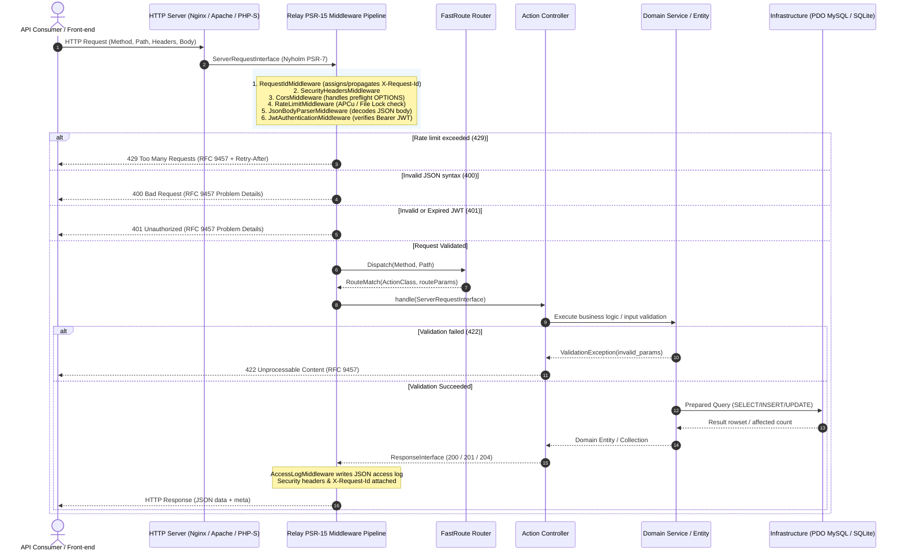
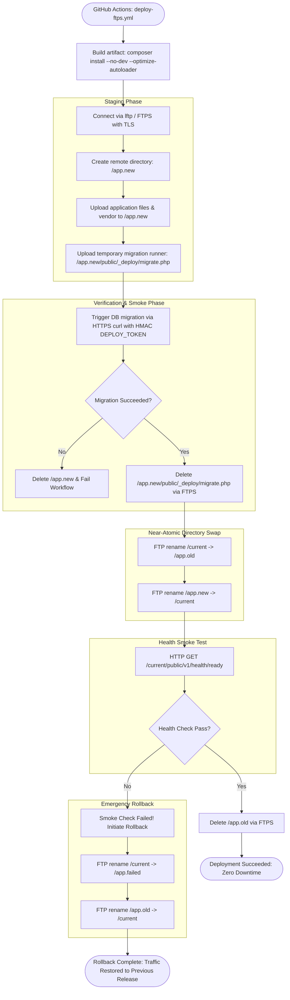

# Architecture & Technical Design: php-api-foundation

## 1. Overview & Core Philosophy
`php-api-foundation` provides a production-grade, dependency-light REST API baseline targeting PHP 8.3+. It is architected to satisfy two operational requirements:
1. **Low-cost shared hosting (cPanel/DirectAdmin over FTPS/SFTP)** without SSH shell access or Composer runtime execution.
2. **Containerized cloud deployments (AWS ECS Fargate, Azure App Service)** with sub-5ms latency, immutable infrastructure, and strict OIDC-based CI/CD pipelines.

The architecture emphasizes:
- **Zero Framework Monoliths**: Pure PSR-7 (Nyholm) and PSR-15 (Relay) pipeline with FastRoute and PHP-DI.
- **Strict IETF Standards**: RFC 9457 (Problem Details for HTTP APIs), RFC 7519 (JSON Web Tokens), RFC 7232 (Conditional Requests / ETag), and OpenAPI 3.1.
- **Security by Design**: Argon2id password hashing, rotating refresh token families with automatic reuse detection, least-privilege IAM roles, and parameterized PDO queries.

---

## 2. Request Lifecycle & Middleware Pipeline

Every HTTP request traverses a linear PSR-15 middleware pipeline before reaching route actions:



### Pipeline Sequence
1. **`ErrorHandlerMiddleware`**: Outermost try-catch wrapper converting all uncaught exceptions into RFC 9457 Problem Details responses (`application/problem+json`). Leaks zero internal traces or credentials in production.
2. **`RequestIdMiddleware`**: Extracts incoming `X-Request-Id` or generates a cryptographically random UUIDv4; attaches it to the request attributes and response headers.
3. **`SecurityHeadersMiddleware`**: Emits defensive HTTP headers (`X-Content-Type-Options: nosniff`, `X-Frame-Options: DENY`, `Strict-Transport-Security`, `Content-Security-Policy: default-src 'none'`).
4. **`CorsMiddleware`**: Validates request origins against configured whitelist, responds to preflight `OPTIONS` requests, and sets headers.
5. **`RateLimitMiddleware`**: Checks client quota (by IP or authenticated subject) using APCu or atomic file locking; responds with `429 Too Many Requests` when quota is exhausted.
6. **`JsonBodyParserMiddleware`**: Intercepts requests with `Content-Type: application/json`, verifies valid JSON syntax, and injects decoded data into parsed body attributes.
7. **`JwtAuthenticationMiddleware`**: Evaluates optional/mandatory Bearer tokens; verifies HS256 signatures, issuer, and expiration; sets `user_id` attribute on the request.
8. **`AccessLogMiddleware`**: Formats request method, path, status, duration (ms), memory usage, and request ID into structured JSON logs.

---

## 3. Authentication & Refresh Token Family State Machine

The foundation uses short-lived JWT access tokens (15 minutes) paired with rotating refresh tokens (30 days) managed through **Token Families** to prevent replay and token theft:

```mermaid
stateDiagram-v2
    [*] --> ActiveFamily: User Login (POST /v1/auth/login)
    
    state ActiveFamily {
        [*] --> TokenIssued: Issue Token gen-1 (family_id=F1, seq=1)
        TokenIssued --> TokenUsedAndRotated: POST /v1/auth/refresh with gen-1
        TokenUsedAndRotated --> TokenIssuedNext: Revoke gen-1; Issue gen-2 (family_id=F1, seq=2)
        TokenIssuedNext --> ActiveFamily: Client holds valid gen-2
    }

    state CompromisedFamily {
        [*] --> AttackDetected: POST /v1/auth/refresh with already revoked gen-1
        AttackDetected --> RevokeEntireFamily: Token reuse alarm triggered!
        RevokeEntireFamily --> Invalidated: Revoke ALL tokens where family_id = F1
    }

    ActiveFamily --> CompromisedFamily: Attacker attempts to replay stolen gen-1 token
    ActiveFamily --> [*]: User Logout (POST /v1/auth/logout)
    CompromisedFamily --> [*]: All tokens dead; User must re-authenticate
```

### Rotation Algorithm
1. **Creation**: When a user logs in, a unique `family_id` (UUIDv4) is minted with `sequence = 1`. A plain UUID token is returned to the user, and its SHA-256 hash is recorded in `refresh_tokens`.
2. **Rotation**: When `/v1/auth/refresh` is called with a valid token:
   - The presented token is marked `is_revoked = 1, revoked_at = NOW()`.
   - A new token in the same family is minted with `sequence = sequence + 1`.
   - A fresh 15-minute JWT is issued.
3. **Reuse Detection**: If `/v1/auth/refresh` receives a token that is already marked `is_revoked = 1`:
   - An attack is detected (stolen token replay).
   - All tokens associated with that `family_id` are revoked immediately (`UPDATE refresh_tokens SET is_revoked = 1 WHERE family_id = :family_id`).
   - The request is rejected with `401 Unauthorized` (`code: TOKEN_FAMILY_REVOKED`).

---

## 4. FTPS Near-Atomic Swap & Rollback Pipeline

For zero-shell shared hosting environments, deployment uses a near-atomic directory swap pattern executed over FTPS/SFTP:



### Safety & Cleanup Guarantees
- The temporary migration runner `public/_deploy/migrate.php` is protected by a short-lived HMAC token (`DEPLOY_TOKEN`) signed with the current UTC timestamp.
- The migration file is deleted over FTPS immediately after execution, verified by asserting that subsequent requests return `404 Not Found`.
- If health checks fail against `/v1/health/ready`, an automatic inverse directory swap restores `/app.old` to `/current`.

---

## 5. Architectural Decision Records (ADRs) Index
- [ADR-0001: Stack Selection](file:///docs/adr/ADR-0001-stack-selection.md) — Plain PHP 8.3 + FastRoute + PSR-7/15 + PHP-DI + Phinx vs. Laravel/Symfony.
- [ADR-0002: Cloud Compute Target AWS](file:///docs/adr/ADR-0002-cloud-compute-target-aws-fargate.md) — AWS ECS Fargate vs. App Runner.
- [ADR-0003: Rate Limiting Storage](file:///docs/adr/ADR-0003-rate-limiting-storage.md) — APCu + Atomic File-Lock vs. Redis.
- [ADR-0004: Cloud Compute Target Azure](file:///docs/adr/ADR-0004-azure-compute-target-app-service.md) — Azure App Service Linux Container vs. Azure Container Apps.
